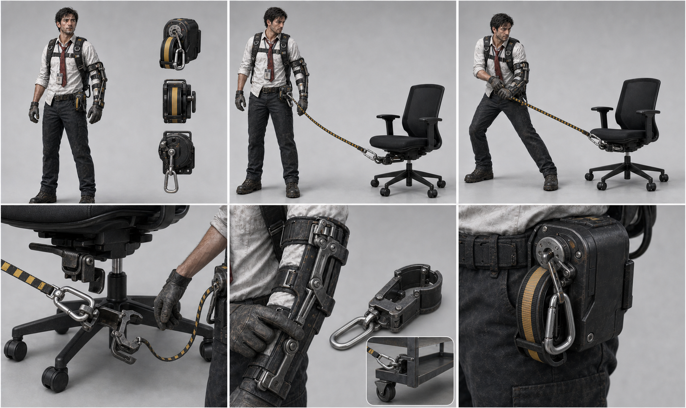
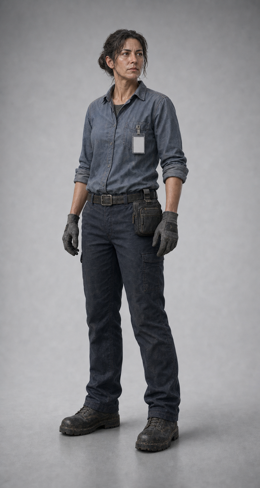
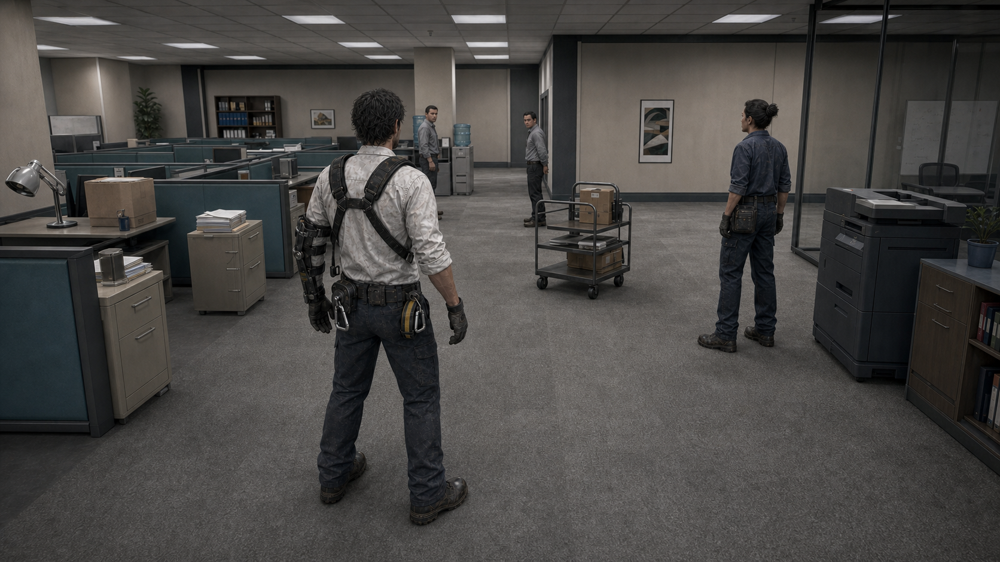
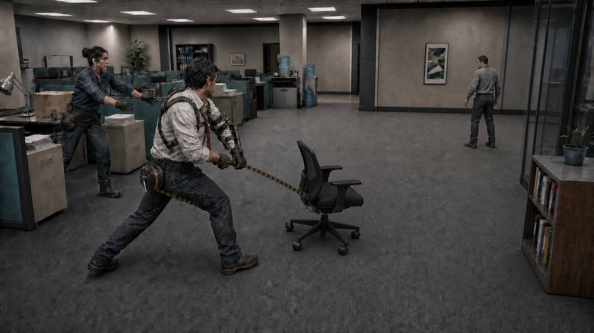
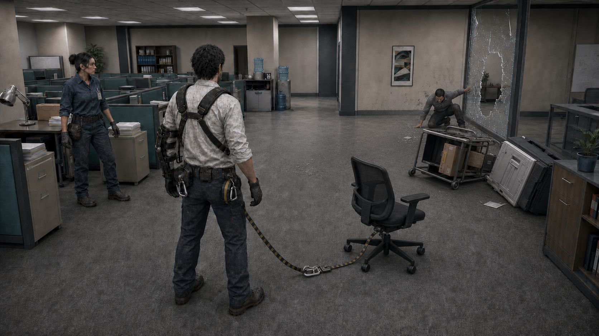
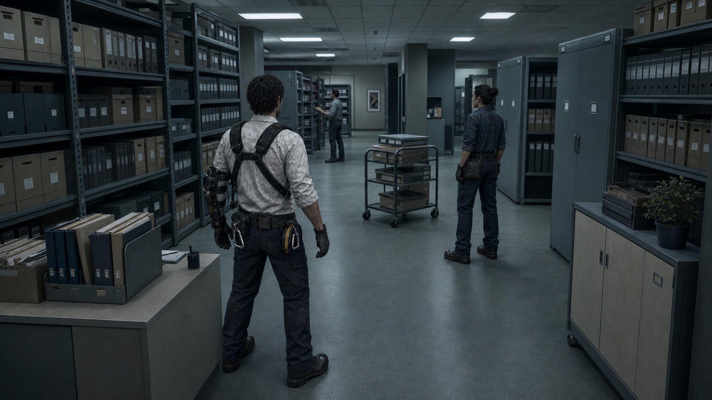
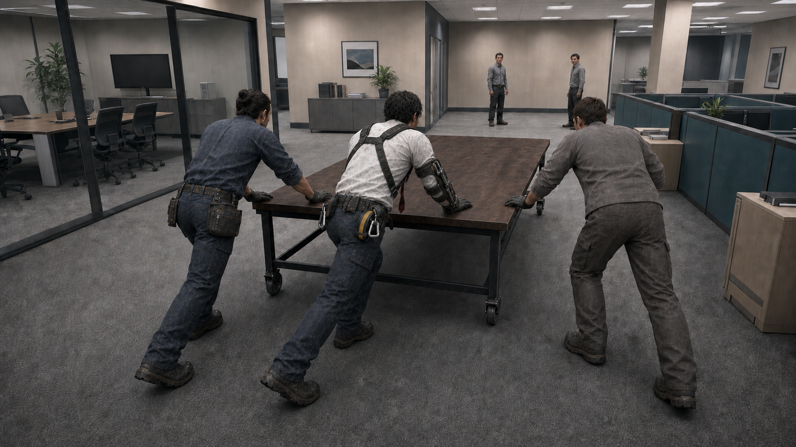

# BREAK NOTICE

> 1인 개발용 3D TPS 물리 액션 Roguelite — Design Baseline `0.1.0`

`0.1.0`은 저장소·설계 문서 버전이며 Gate 통과 상태를 뜻하지 않는다.

BREAK NOTICE는 해고 통보를 받은 사내 자산관리 직원이 산업용
화물 장비와 동료의 물리적 릴레이로 사무용품을 직접 받아 던지고
방향을 바꾸며, 읽을 수 있는 연쇄 충돌로 사무실의 국소 상태를
재구성하는 3인칭 물리 액션 게임이다.

**Grounded world. Absurd physics.**
















## 현재 상태

| 항목 | 상태 |
|---|---|
| 현재 Phase label | PRE-PRODUCTION / G3 TECHNICAL BASELINE |
| G1 Requirements | PASSED / OWNER-APPROVED BASELINE |
| G2 Design | PASSED / OWNER-APPROVED BASELINE |
| G3 Technical | NOT PASSED / CURRENT BASELINE WORK |
| G3 Technical Baseline | OWNER-APPROVED / FINAL AUDIT PENDING |
| G3 Technical checklist | 6 / 6 |
| Design Freeze | 28 / 32 |
| Exact Editor/package documentation lock | Unity `6000.3.20f1`; URP `17.3.0`; Input System `1.20.0`; Cinemachine `3.1.7`; Test Framework `1.6.0` |
| Production Visual Lock sequence | COMPLETE |
| Full Design Lock | INCOMPLETE |
| Phase label review | COMPLETED / OWNER-APPROVED |
| 게임 정체성 | LOCKED |
| 3D TPS / Unity 6 / URP | LOCKED |
| 초능력 Grab 제거 | LOCKED |
| 직접 집기 + 화물 스트랩 + 동료 패스 | LOCKED |
| 주인공 비주얼 `CHR_00 v002` | LOCKED |
| 실제 게임 카메라 `PGT_01 v002` | LOCKED |
| 동료 1종 비주얼 `CHR_01 v001` | LOCKED |
| 장비 작동 시트 `GEAR_01 v002` | LOCKED |
| 의자 리디렉션 Core Loop `PGT_02 v010` | VISUAL LOCKED / FUNCTIONAL DRAFT |
| Chain Reaction Aftermath `PGT_03 v003` | VISUAL LOCKED / FUNCTIONAL DRAFT |
| Night Archive Lighting `LGT_01 v001` | VISUAL LOCKED / TECHNICAL DRAFT |
| Conference Table Team Finisher `FIN_01 v003` | VISUAL LOCKED / FEATURE COULD / FUNCTIONAL DRAFT |
| Graybox 재미 검증 | NOT STARTED |
| Implementation Gate | CLOSED |
| Unity project | NOT CREATED / PLACEHOLDERS ONLY |
| 본 제작 | BLOCKED BY G3 FINAL AUDIT + REMAINING GATES |

G3 기술 책임과 exact documentation lock은 Owner-approved지만 G3는
Final Audit 전까지 `NOT PASSED`다. AI Navigation은 Prototype에서
Deferred이고 optional/later system은 first wave 밖이다. 현재
Unity project, package file, code, Scene, Prefab 또는 test는 생성되지
않았으며 Bootstrap, Graybox와 구현은 승인되지 않았다.

## 가장 먼저 읽을 문서

1. [`AGENTS.md`](AGENTS.md) — Codex와 모든 작업자의 절대 규칙
2. [`docs/00_project/PROJECT_CHARTER.md`](docs/00_project/PROJECT_CHARTER.md)
3. [`docs/01_requirements/PRODUCT_REQUIREMENTS.md`](docs/01_requirements/PRODUCT_REQUIREMENTS.md)
4. [`docs/02_design/MASTER_GDD.md`](docs/02_design/MASTER_GDD.md)
5. [`docs/03_art/ART_DIRECTION.md`](docs/03_art/ART_DIRECTION.md)
6. [`docs/04_technical/G3_TECHNICAL_BASELINE.md`](docs/04_technical/G3_TECHNICAL_BASELINE.md)
7. [`docs/05_production/WATERFALL_PLAN.md`](docs/05_production/WATERFALL_PLAN.md)
8. [`docs/06_codex/CODEX_EXECUTION_PROTOCOL.md`](docs/06_codex/CODEX_EXECUTION_PROTOCOL.md)
9. [`docs/07_quality/ACCEPTANCE_TESTS.md`](docs/07_quality/ACCEPTANCE_TESTS.md)

## 저장소 구조

```text
break-notice/
├─ AGENTS.md                         # Codex 최상위 지시서
├─ README.md
├─ docs/
│  ├─ 00_project/                    # 헌장, 용어, 의사결정, 변경관리
│  ├─ 01_requirements/               # 요구사항, 비기능 요구, 추적표
│  ├─ 02_design/                     # 게임 설계와 시스템 명세
│  ├─ 03_art/                        # 아트, 캐릭터, 장비, VFX 기준
│  ├─ 04_technical/                  # Unity 기술 설계와 아키텍처
│  ├─ 05_production/                 # 폭포수 단계, 범위, 리스크, 게이트
│  ├─ 06_codex/                      # Codex 실행 프로토콜과 작업 템플릿
│  ├─ 07_quality/                    # 테스트, 인수 기준, 플레이테스트
│  ├─ 08_marketing/                  # 포지셔닝, 트레일러, Incident Report
│  ├─ 09_adrs/                       # Architecture Decision Records
│  └─ archive/                       # 폐기·대체된 과거 문서
├─ references/
│  ├─ approved/                      # Canon 비주얼
│  ├─ exploration/                   # 방향 탐색 이미지 10종
│  └─ archive/                       # 이전 생성 결과와 구버전
├─ Game/                             # Unity 프로젝트 예정 루트
│  ├─ Assets/_Project/               # 구현 시작 전 빈 구조만 유지
│  ├─ Packages/
│  └─ ProjectSettings/
├─ tasks/                            # 승인된 Codex 작업 티켓
└─ .github/                          # 이슈·PR 템플릿
```

## 절대 고정 사항

- 게임은 **3D TPS**다.
- documentation lock은 **Unity 6000.3.20f1**, **URP 17.3.0**,
  **Input System 1.20.0**, **Cinemachine 3.1.7**,
  **Unity Test Framework 1.6.0**이고 물리는 **GameObject 기반
  PhysX** 방향이다.
- 원거리 염력이나 마법 Grab은 없다.
- 붉은 넥타이는 복장과 시각적 상징일 뿐 물체 연결 도구가 아니다.
- 물체 연결은 허리 릴에서 나오는 **검정·황색 산업용 화물 스트랩, 금속 카라비너, 교체식 클램프**로 하중 지지 금속 Anchor에 수행한다.
- 일반 전투의 활성 동료는 **1명**, 특수 피니셔에서만 최대 2명이다.
- LGT_01은 Records Archive 지역의 after-hours 조명 변주이며 게임 전체의 Global Lighting 또는 Color Grading 기준이 아니다.
- FIN_01은 PR-F-022 `COULD` 기능의 Visual-only conditional direction이며 Vertical Slice 또는 최종 제품 범위에 자동 편입되지 않는다.
- 코미디는 과장된 얼굴이 아니라 진지한 인물과 황당한 물리 결과의 대비에서 나온다.
- 실제 구현은 승인된 요구사항과 인수 테스트 없이는 시작하지 않는다.

## Git 사용 원칙

- `main`: 승인된 기준선만 유지한다.
- 기능 작업은 `task/<ID>-<short-name>` 브랜치에서 수행한다.
- 커밋은 하나의 목적만 가진다.
- 설계 변경은 코드로 먼저 밀어 넣지 않는다. 반드시 Change Request와 ADR을 먼저 승인한다.

## 라이선스

이 저장소의 게임 기획, 문서, 이미지와 프로젝트 자산은 공개 사용을 허가하지 않는 독점 자료다. 자세한 내용은 [`LICENSE.md`](LICENSE.md)를 따른다.
