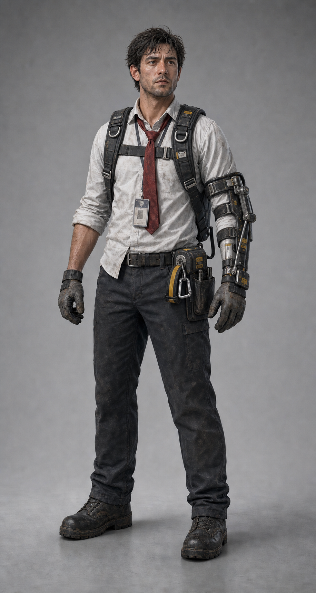
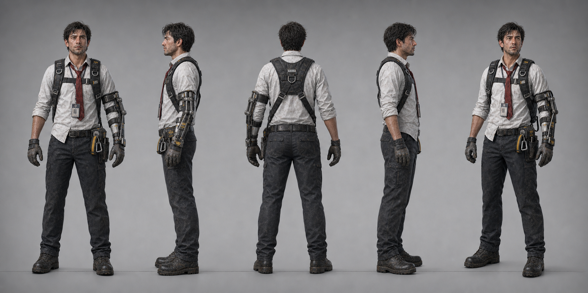

# Player Visual Specification

## 승인 이미지

`CHR_00_Player_Identity_Lock_v002_FINAL`을 공식 비주얼 기준으로 승인한다.

## Approved Turnaround Production Support

`CHR_00_Player_Turnaround_v001_FINAL`은 Human Owner가 승인하고
ADR-0018로 등록한 `LOCKED PRODUCTION SUPPORT`다. 정확한 다섯 전신 뷰,
중립 modeling pose, 의복·하네스·브레이스·허리 릴·보관 스트랩·
카라비너 continuity와 후면·측면 제작 가독성을 보조한다.

- Approved path:
  `references/approved/characters/CHR_00_Player_Turnaround_v001_FINAL.png`
- SHA-256:
  `8a852d77296ebf39cb3cf81c51d931d141dff63f358182ab5638bbbd4329d214`
- Role: orthographic and modeling continuity only

CHR_00 Identity의 주 권위는
`CHR_00_Player_Identity_Lock_v002_FINAL`, 이 문서의 Canonical Elements와
ADR-0007이다. Turnaround는 그 권위에 종속되며 새로운 Identity,
gameplay, 장비 기능, sequence, 3D topology·rig·material, Unity asset,
Graybox 또는 구현 권한을 만들지 않는다. 정확한 모공·주름·오염·볼트·
라벨·미세 비대칭·조명과 spacing은 Non-Canon이다.

## Canonical Elements

- 현실적인 성인 남성 비율
- 지치고 집중된 자산관리·시설 직원 인상
- 구겨지고 오염된 흰 셔츠, 걷은 소매
- 짧고 느슨한 암적색 넥타이
- 사원증
- 어두운 작업 바지
- 낡은 작업 장갑과 안전화
- 산업용 하중 분산 하네스
- 한쪽 팔의 외부 장착형 하중 보조 브레이스
- 허리 장착형 수축식 화물 스트랩 릴
- 검정·황색 스트랩
- 금속 카라비너
- 제한된 산업 안전 마킹

## Non-Canonical Elements

- 이미지의 피부·머리카락·스튜디오 조명 품질
- 개별 볼트, 라벨, 흠집의 정확한 위치
- 얼굴 모공과 셔츠 주름 수
- 생성 이미지의 우연한 비대칭

## Gameplay Silhouette

- 오른팔 또는 지정된 한쪽 팔의 브레이스로 비대칭 실루엣 형성
- 허리 릴과 황색 스트랩이 옆·뒤 3인칭에서도 읽혀야 함
- 넥타이는 앞·옆 운동감을 주되 물체와 연결되지 않음
- Medium을 들 때 얼굴과 조준점을 가리지 않음

## 3D Simplification

- 장비 작은 파츠 50% 이상 통합 가능
- 셔츠 주름은 normal map 중심
- 머리카락은 카드 또는 큰 덩어리 메시
- 공구는 실루엣이 중요한 2~3개만 실제 메시
- 넥타이는 3~5본 기반, 과도한 Cloth Simulation 금지
- 브레이스 손은 일반 작업 장갑과 분리

## Prohibited Changes

- 슈퍼히어로·보디빌더 체형
- 전투용 사이버네틱 손
- 방탄복·탄창·군용 몰리 장비
- 넥타이를 물체에 연결
- 장비 발광 오라
- 애니메이션 영화형 얼굴
