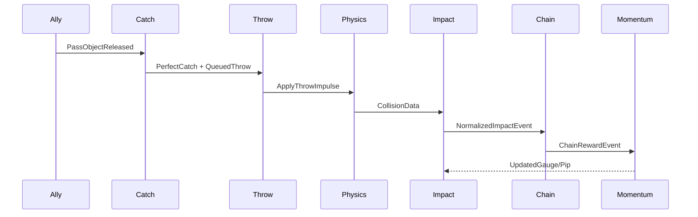

# Software Architecture

## Dependency Rule

상위 표현 계층은 하위 게임·시뮬레이션 계층을 호출할 수 있지만, 시뮬레이션이 UI·카메라 구현을 직접 참조하지 않는다.

## Component Responsibilities

### PlayerMotor

이동, 회피, Vault, 현재 이동 제약. 물체 선택·투척 판정은 담당하지 않는다.

### PlayerInteractionController

Catch > Strap Anchor > Scoop 우선순위와 문맥 입력을 결정한다.

### CarryController

물체 소유 상태, 손 Anchor, 무게별 이동 제약, 놓기.

### ThrowController

Quick/Charged/Queued Throw와 투척 초기 조건을 생성한다.

### CargoStrapController

Attach, 장력, 거리, 허용 각도, Release, 안전 해제. 물체를 순간이동하지 않는다.

### AllyRelayController

Relay Position, 재고, 패스 요청, 투척·굴림, Suppressed.

### ImpactResolver

원시 Collision 데이터를 표준화하고 무게·재질·속도·각도에 따라 게임 결과를 계산한다.

### CausalChainService

Lineage 생성·전파·종료·중복 억제·디버그.

### MomentumService

보상 정책, 게이지, Pip, 소비.

### BreakableObject

임계값, 상태 교체, 큰 파편 활성화, Lineage 전달.

### FeedbackDirector

표준 게임 이벤트를 카메라·VFX·오디오로 변환한다.

## Event Flow Example

## Anti-Patterns

- Collision callback에서 UI, 오디오, Momentum을 모두 직접 호출
- ScriptableObject에 현재 체력·현재 Momentum 저장
- 전역 static 목록으로 모든 물체 검색
- 동료 AI와 전투 판정을 하나의 거대 MonoBehaviour에 결합
- 물리 프레임 순서에 의존한 암묵적 상태 변경
